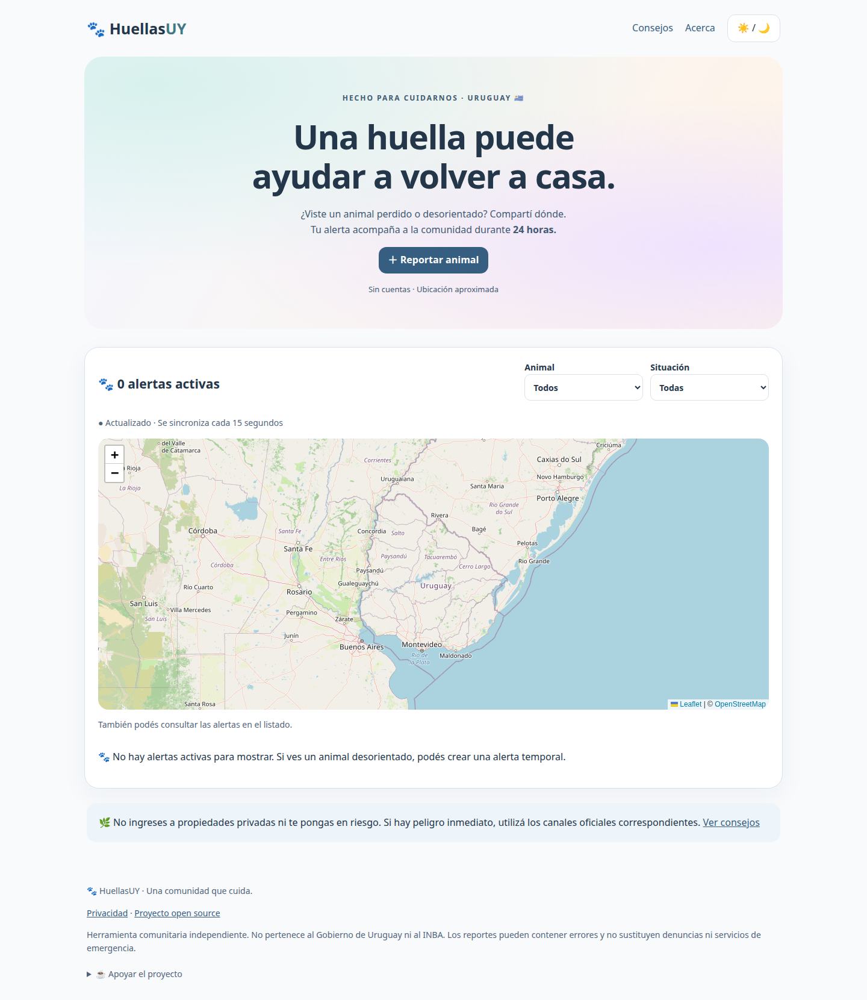

# HuellasUY 🐾
Mapa comunitario temporal de animales perdidos, encontrados o vistos en Uruguay. Las alertas expiran automáticamente en 24 horas.



Prototipo open source, creado por Martín Martínez García. Sin cuentas, fotos, chats, rastreadores ni información de contacto. Diseño pastel, modo oscuro y mapa accesible mediante listado alternativo.

## Cómo funciona
Marcás dónde viste al animal, escribís una descripción y publicás. Otros visitantes consultan la misma base; su pantalla se actualiza cada 15 segundos mientras está visible. Guardá tu enlace privado para eliminar la alerta antes de que venza. No publiques datos personales.

## Tecnologías y arquitectura
Python 3.12+, Flask, SQLite, HTML/CSS/JavaScript y Leaflet 1.9.4 con OpenStreetMap. Flask sirve interfaz y API en un mismo origen. GitHub Pages no ejecuta este backend.

## Ejecutar
En un equipo con Python y soporte venv:
```bash
git clone https://github.com/MartnMartnez14/huellasuy.git
cd huellasuy
python3 -m venv .venv
.venv/bin/python -m pip install -r requirements.txt
.venv/bin/python app.py
```
Abrir http://127.0.0.1:5000. En este equipo ya está preparado un entorno llamado `.venv-system`:
```bash
.venv-system/bin/python app.py
.venv-system/bin/python -m pytest -q
```
No hace falta instalar paquetes del sistema para usar ese entorno. No versionarlo.

## Configuración
Exportar variables antes de iniciar; `.env.example` es orientativo y no se carga automáticamente. `DATABASE_PATH`: archivo SQLite (por defecto `instance/huellasuy.db`). `SECRET_KEY`: secreto estable para derivar identificadores de frecuencia; si falta se genera un archivo privado junto a la base. `PUBLIC_ORIGIN`: origen externo exacto, sin barra final. En producción fijarlo explícitamente. La vida de reportes es siempre 24 horas.

## Pruebas
```bash
.venv-system/bin/python -m pytest -q
```
Cubren creación, dos clientes compartiendo datos, reinicio, eliminación, validaciones, seguridad, filtros y expiración exacta. La CI usa Python 3.12.

## Publicación
Ver [guía de despliegue](docs/deployment.md). Se necesita un servicio que ejecute Python, HTTPS y un volumen persistente para SQLite. La aplicación todavía no tiene URL pública. Repositorio previsto: [MartnMartnez14/huellasuy](https://github.com/MartnMartnez14/huellasuy). No usar un disco efímero para reportes compartidos.

## Documentación
[Arquitectura](docs/architecture/architecture.md) · [Seguridad](docs/security/security-model.md) · [Roadmap](docs/roadmap.md) · [Instrucciones para agentes](AGENTS.md).

## Privacidad y fuentes
Ubicaciones redondeadas a tres decimales; sin historial. Tokens privados solo en fragmentos de enlaces y cuerpos JSON. Datos vencidos inaccesibles inmediatamente; limpieza automática por actividad y comando periódico opcional. Las páginas `/privacy`, `/help` y `/about` explican límites y fuentes oficiales. Los proveedores externos reciben datos de conexión normales.

## Contribuir
Leer AGENTS.md, proponer cambios pequeños, ejecutar pytest y comprobar móvil. No cambiar temporalidad ni introducir datos ficticios públicos. Reportar problemas de seguridad sin publicar tokens ni datos privados. Licencia MIT.

## Verificación visual reproducible
Con un servidor usando una base aislada de pruebas en el puerto 5000 y Playwright/Chrome disponibles, ejecutar `node scripts/browser_qa.cjs`. Opcionalmente definir `PLAYWRIGHT_MODULE` y `CHROME_PATH`. El script crea una alerta identificada como QA y la elimina: no usar contra una base pública. Comprueba siete anchos, dos sesiones independientes, ubicación concedida/rechazada, publicación y eliminación compartidas; genera las vistas incluidas.

Las tarjetas se muestran en lista debajo del mapa. «Ver en el mapa» centra y abre la ubicación aproximada sin solicitar ubicación del visitante. Los marcadores abiertos se conservan al actualizar y se retiran al vencer/eliminar la alerta. El apoyo voluntario está visible en el pie.

## API pública
- `GET /api/reports`: alertas activas y hora del servidor; filtros `animal_type` y `status_type`.
- `GET /api/reports/<id>`: detalle activo; un reporte vencido o eliminado no expone datos.
- `POST /api/reports`: creación validada; devuelve el token privado solo al autor.
- `DELETE /api/reports/<id>`: elimina usando `delete_token` en JSON.
- `GET /health`: comprobación mínima del servicio.

## Apoyar el proyecto
¿Te gustó el proyecto? Si quieres colaborar voluntariamente, puedes invitarme a un cafecito o mate.

[☕ Ko-fi](https://ko-fi.com/martinmartinezgarcia) · [💙 PayPal](https://www.paypal.com/paypalme/blufferedtwitch) · [🛰️ Internet satelital Starlink](https://starlink.com/es?referral=RC-DF-5848974-78640-68&app_source=share)

El enlace de Starlink es de afiliado y puede beneficiar al autor. Los beneficios dependen de las condiciones vigentes de Starlink; no se garantiza un mes gratuito.

## Estado y límites
Versión inicial: prototipo funcional local. Sincronización por consultas cada 15 segundos; necesita Flask y almacenamiento persistente, no solamente GitHub Pages. El mapa advierte sobre ubicaciones aparentemente fuera de Uruguay, pero aún no aplica validación territorial estricta. Moderación avanzada y despliegue gratuito se evaluarán después. Ver [resultados de verificación](docs/verification.md).
