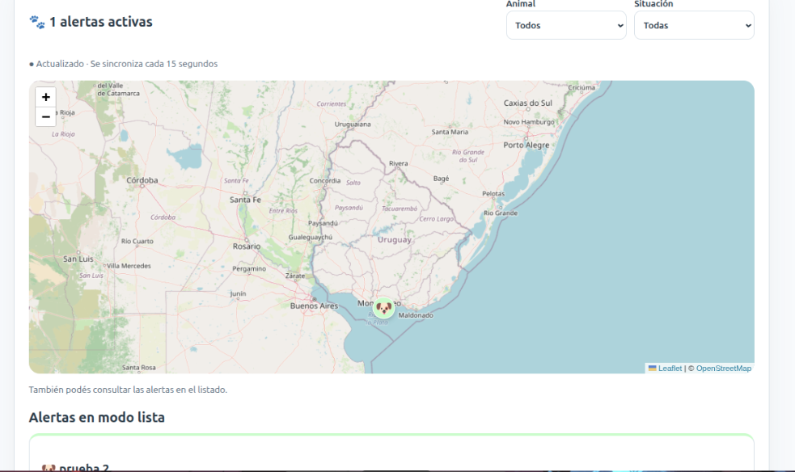
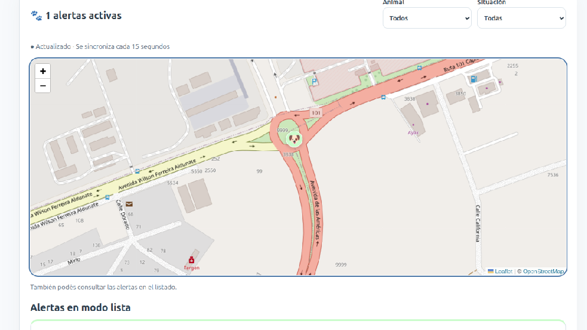
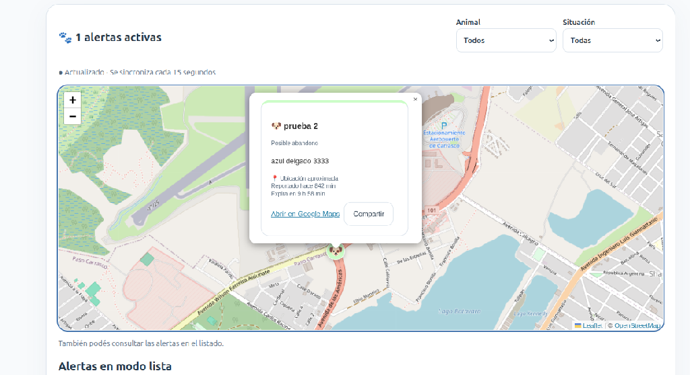
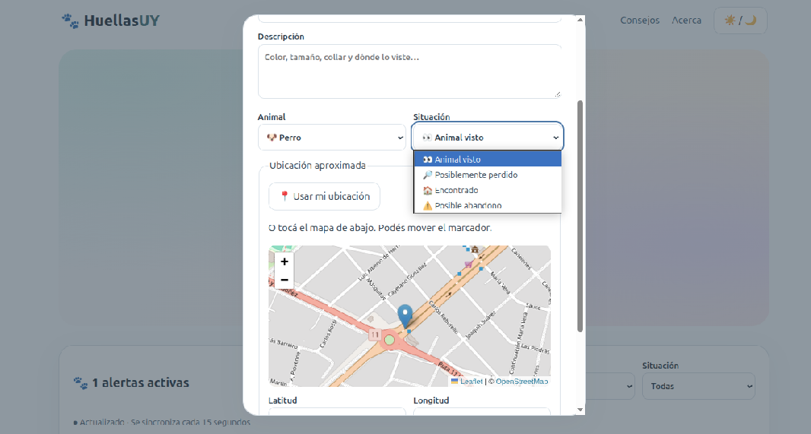
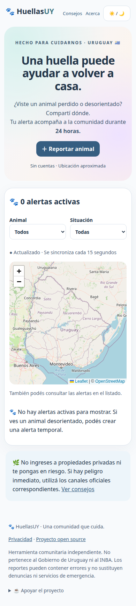

# HuellasUY 🐾
Mapa comunitario temporal de animales perdidos, encontrados o vistos en Uruguay. Las alertas expiran automáticamente en 24 horas.

**[Abrir HuellasUY — aplicación pública](https://buerianiloba98.pythonanywhere.com/)**

Primera versión comunitaria gratuita y open source, alojada en **PythonAnywhere**. Creada por Martín Martínez García.

## Mini tutorial: usar HuellasUY
No necesitás instalar nada ni saber programación. Mientras la instancia siga en v1, no requiere cuenta; al activar v2, primero elegí Crear cuenta, verificá el correo y entrá para consultar mapa, lista y enlaces compartidos.

1. **Abrí la web** desde el celular o la computadora usando el enlace de arriba.
2. **Consultá las alertas** en el mapa o en la lista de abajo. Usá los filtros de animal y situación para encontrar lo que buscás.
3. **Ubicá un animal:** tocá su marcador o pulsá **«📍 Ver en el mapa»** al final de su tarjeta. El mapa se centra en el lugar aproximado donde fue visto; no pide tu ubicación para esta acción.
4. **Creá un aviso:** pulsá **«＋ Reportar animal»**, escribí un título y una descripción útil, y elegí el animal y su situación.
5. **Marcá dónde lo viste:** pulsá **«Usar mi ubicación»** solo si estás en ese lugar, o tocá el mapa del formulario. Podés mover el marcador; si denegás el permiso, usá la selección manual.
6. **Publicá y guardá el enlace privado** que aparece al finalizar. Permite eliminar tu alerta sin cuenta; no lo compartas con otras personas.
7. **Actualizá la comunidad:** si el animal ya no está allí, abrí ese enlace privado y eliminá la alerta. Si no la eliminás, desaparece automáticamente al cumplir **24 horas**.

Para difundir una alerta usá **Compartir**: abre las opciones del dispositivo o permite copiar su enlace público. **Abrir en Google Maps** muestra su ubicación aproximada en ese servicio.

Mapa y lista consultan novedades cada **15 segundos** mientras la página está visible, y al volver a ella. Es actualización casi en tiempo real; no hace falta recargar manualmente. Si se pierde la conexión, la web lo informa.

Publicá situaciones reales, evitá datos personales o direcciones de viviendas y no te pongas en riesgo para acercarte a un animal. HuellasUY es independiente y no sustituye denuncias, veterinarios ni emergencias.

## Capturas de la aplicación
Capturas proporcionadas por el autor el 3 de octubre de 2026. Los avisos visibles son **datos de demostración de pruebas**, no casos reales ni alertas para atender. Estas imágenes documentan la interfaz; no cargan reportes ficticios en la aplicación.

### Mapa general y lista


### Ubicación ampliada


### Detalle de una alerta


### Formulario de reporte


<details>
<summary>Vistas adicionales de escritorio y móvil</summary>




Estas vistas corresponden a una etapa anterior del prototipo.

</details>

Proyecto open source, creado por Martín Martínez García. La entrega v1 no tiene cuentas; v2 incorpora cuentas verificadas de forma optativa para el despliegue. Fotos, chats e información de contacto siguen fuera de esta entrega. Diseño pastel, modo oscuro y mapa accesible mediante listado alternativo.

## Cómo funciona
Marcás dónde viste al animal, escribís una descripción y publicás. Otros visitantes consultan la misma base; su pantalla se actualiza cada 15 segundos mientras está visible. Guardá tu enlace privado para eliminar la alerta antes de que venza. No publiques datos personales.

## Entrega v2.0: cuentas verificadas
La entrega de cuentas está implementada y **desactivada por defecto hasta completar el despliegue**. Incluye acceso, recuperación, emoji de usuario, borrado de alertas propias y administración por correo verificado. La aplicación online no se actualiza con solo subir a GitHub: requiere activar y probar PythonAnywhere. Fotos, comentarios, contactos y duraciones opcionales se trabajarán otro día. Ver [cuentas y activación](docs/accounts.md).

## Tecnologías y arquitectura
Python 3.12+, Flask, SQLite, HTML/CSS/JavaScript y Leaflet 1.9.4 con OpenStreetMap. Flask sirve interfaz y API en un mismo origen. GitHub Pages no ejecuta este backend.

## Para desarrolladores: ejecutar localmente
En un equipo con Python y soporte venv:
```bash
git clone https://github.com/MartnMartnez14/huellasuy.git
cd huellasuy
python3 -m venv .venv
.venv/bin/python -m pip install -r requirements.txt
.venv/bin/python app.py
```
Abrir http://127.0.0.1:5000. El entorno virtual se crea en tu propio equipo y no se incluye en Git. En Windows, usar `.venv\Scripts\python.exe` en lugar de `.venv/bin/python`.

## Configuración
Exportar variables antes de iniciar; `.env.example` es orientativo y no se carga automáticamente. `DATABASE_PATH`: archivo SQLite (por defecto `instance/huellasuy.db`). `SECRET_KEY`: secreto estable para derivar identificadores de frecuencia; si falta se genera un archivo privado junto a la base. `PUBLIC_ORIGIN`: origen externo exacto, sin barra final. En producción fijarlo explícitamente. La vida de reportes es siempre 24 horas.

## Pruebas
```bash
.venv/bin/python -m pytest -q
```
Cubren creación, dos clientes compartiendo datos, reinicio, eliminación, validaciones, seguridad, filtros y expiración exacta. La CI usa Python 3.12.

## Publicación
Ver [guía de despliegue](docs/deployment.md). Se necesita un servicio que ejecute Python, HTTPS y un volumen persistente para SQLite. La versión pública está alojada gratuitamente en [PythonAnywhere](https://buerianiloba98.pythonanywhere.com/). Repositorio: [MartnMartnez14/huellasuy](https://github.com/MartnMartnez14/huellasuy). No usar un disco efímero para reportes compartidos.

## Documentación
[Arquitectura](docs/architecture/architecture.md) · [Seguridad](docs/security/security-model.md) · [Roadmap](docs/roadmap.md) · [Instrucciones para agentes](AGENTS.md).

## Privacidad y fuentes
Ubicaciones redondeadas a tres decimales; sin historial. Tokens privados solo en fragmentos de enlaces y cuerpos JSON. Datos vencidos inaccesibles inmediatamente; limpieza automática por actividad y comando periódico opcional. Las páginas `/privacy`, `/help` y `/about` explican límites y fuentes oficiales. Los proveedores externos reciben datos de conexión normales.

## Feedback y colaboración
Se aceptan ideas, sugerencias, reportes de errores, mejoras de accesibilidad y pull requests. Podés proponer cambios en [GitHub Issues](https://github.com/MartnMartnez14/huellasuy/issues). No incluyas enlaces privados de eliminación, credenciales ni datos personales al informar un problema.

El autor confirmó pruebas desde celular y PC de publicación, visualización y eliminación compartida, y confirmó el 3 de octubre de 2026 que la alerta de prueba desapareció automáticamente tras 24 horas. Son comprobaciones manuales; los resultados automatizados están en [verificación](docs/verification.md).

## Contribuir
Leer AGENTS.md, proponer cambios pequeños, ejecutar pytest y comprobar móvil. No cambiar temporalidad ni introducir datos ficticios públicos. Reportar problemas de seguridad sin publicar tokens ni datos privados. Licencia MIT.

## Verificación visual reproducible
Con un servidor usando una base aislada de pruebas en el puerto 5000 y Playwright/Chrome disponibles, ejecutar `node scripts/browser_qa.cjs`. Opcionalmente definir `PLAYWRIGHT_MODULE` y `CHROME_PATH`. El script crea una alerta identificada como QA y la elimina: no usar contra una base pública. Comprueba siete anchos, dos sesiones independientes, ubicación concedida/rechazada, publicación y eliminación compartidas; genera las vistas incluidas.

Las tarjetas se muestran en lista debajo del mapa. «Ver en el mapa» centra y abre la ubicación aproximada sin solicitar ubicación del visitante. Los marcadores abiertos se conservan al actualizar y se retiran al vencer/eliminar la alerta. El apoyo voluntario está visible en el pie.

## API pública
- `GET /api/reports`: alertas activas y hora del servidor; filtros `animal_type` y `status_type`.
- `GET /api/reports/<id>`: detalle activo; un reporte vencido o eliminado no expone datos.
- `POST /api/reports`: creación validada; devuelve el token privado solo al autor.
- `DELETE /api/reports/<id>`: elimina usando `delete_token` en JSON.
- `GET /health`: comprobación mínima del servicio.

## Apoyar el proyecto
¿Te gustó el proyecto? Si quieres colaborar voluntariamente, puedes invitarme a un cafecito o mate.

[☕ Ko-fi](https://ko-fi.com/martinmartinezgarcia) · [💙 PayPal](https://www.paypal.com/paypalme/blufferedtwitch) · [🛰️ Internet satelital Starlink](https://starlink.com/es?referral=RC-DF-5848974-78640-68&app_source=share)

El enlace de Starlink es de afiliado y puede beneficiar al autor. Los beneficios dependen de las condiciones vigentes de Starlink; no se garantiza un mes gratuito.

## Estado y límites
Versión inicial comunitaria disponible online en PythonAnywhere. Sincronización por consultas cada 15 segundos; necesita Flask y almacenamiento persistente, no solamente GitHub Pages. El mapa advierte sobre ubicaciones aparentemente fuera de Uruguay, pero aún no aplica validación territorial estricta. Moderación avanzada y mejoras de capacidad se evaluarán según el uso real. El alojamiento gratuito tiene límites y requiere renovación desde su panel. Ver [resultados de verificación](docs/verification.md).
